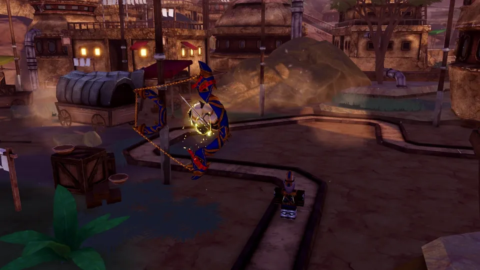
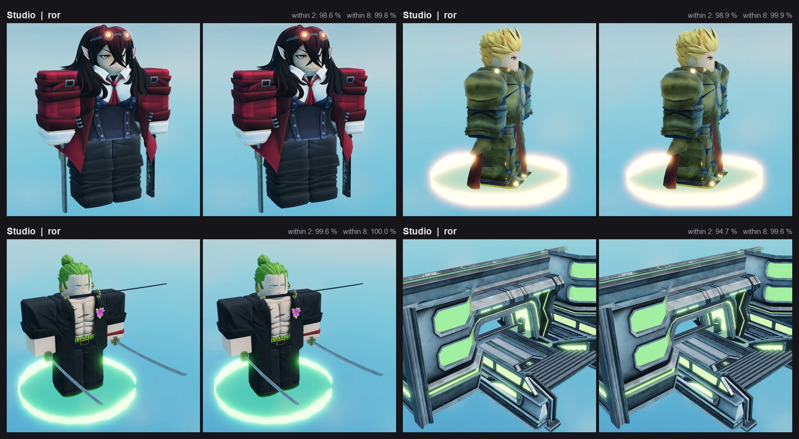
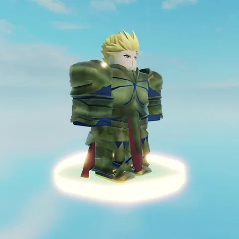

# ror — Offline Renderer for Roblox 3D Objects

`ror` renders Roblox 3D assets offline without opening Roblox Studio or launching a client. It accepts `.rbxm` / `.rbxmx` models, `.rbxl` / `.rbxlx` places, `.rbx` archives of either, Roblox asset IDs, live exports from an open Studio window, and `.luau` scripts.

Output targets Roblox Studio at maximum graphics quality (quality level 21, `Future` lighting), calibrated against captures from a dedicated Studio instance. A background render service keeps the GPU device, pipelines, meshes, textures, and parsed models warm in memory so many processes can render in parallel.

> [!NOTE]
> Nearly all of the code in this repository was written by Anthropic's Claude under maintainer direction. The output is measured against Roblox Studio captures and backed by automated tests, but Claude wrote almost all of the implementation.

[](docs/media/effect-in-a-map.mp4)

An attack effect running inside a match map, rendered frame by frame with no Studio open. The game's own Luau ran inside [ree](https://github.com/Anime-Vanguards/roblox-engine-emulator) to record the scene and timeline, and `ror` rendered the particles, beams, trails, and lighting. [Full-size MP4](docs/media/effect-in-a-map.mp4) (1920x1080, 3 s, looping).



Roblox Studio (left) vs. `ror` (right) with identical camera and lighting settings across three units and a scene slice. The labels report the percentage of pixels across the full 1644x1116 frame within 2/255 and 8/255 of Studio. Studio frames are stored captures from Studio 0.741; `ror` frames come from the current build (`ror compare`, see [docs/parity.md](docs/parity.md)).

[](docs/media/unit-turntable.mp4)

An 8-second 360-degree turntable rendered with `ror video --orbit 360`. Specular highlights, sky reflections, and bloom from the Neon ring track the moving camera. [MP4](docs/media/unit-turntable.mp4).


## Key capabilities

- **Still renders (`ror render`)** — Render models, places, asset IDs, live Studio instances, and `.luau` scripts from any camera angle to PNG. Supports Parts, MeshParts, 2022 and pre-2022 materials, `SurfaceAppearance`, R6/R15 characters, local lights and shadows, sky, atmosphere, fog, post-processing, and GUIs via [rur](https://github.com/Anime-Vanguards/roblox-ui-renderer).
- **Effect playback and video (`ror video`)** — Simulate particles, beams, trails, tweens, property changes, and motion over a timeline. Export stills or MP4, WebM, GIF, APNG, and PNG frame sequences.
- **Luau script inputs** — Pass a `.luau` script that builds a model or plays an effect. `ror` runs it in `ree` and renders whatever it places in `Workspace`.
- **Rendering cost analysis (`ror cost`)** — Estimate Roblox draw calls, triangles, LODs, and software occlusion per camera. Attribute costs to individual instances in estimated phone milliseconds, test edits in memory with visual diffs, and export changes as Lune scripts ([docs/cost-loop.md](docs/cost-loop.md)).
- **Studio parity harness (`ror compare`, `ror studio`)** — Capture the same scene in a dedicated Studio instance and diff it pixel by pixel against `ror`.
- **Shared render service (`ror service`)** — A persistent local daemon per state directory so multiple `ror` invocations share GPU resources and caches concurrently.

## Quick start

### Option 1: Install a release binary

Download the archive for your platform from [Releases](https://github.com/Anime-Vanguards/roblox-object-renderer/releases) and place `ror` (or `ror.exe`) on your `PATH`.

Or install via [Rokit](https://github.com/rojo-rbx/rokit) in `rokit.toml` (Aftman and Foreman also work with the same zip):

```toml
[tools]
ror = "Anime-Vanguards/roblox-object-renderer@0.1.0"
```

> Use Rokit 1.0+ on Linux and macOS. Rokit 0.2.x cannot locate the `ror` binary there because the executable name differs from the repository name.

Need the latest changes on `main`? Download the nightly [canary](https://github.com/Anime-Vanguards/roblox-object-renderer/releases/tag/canary) prerelease (untested as a release and subject to breakage).

Verify your install and run a quick render:

```sh
ror --version
ror render path/to/Model.rbxm --views iso --out out/model
```

Release binaries store caches and output state in your user cache directory; source builds default to `<checkout>/.cache`. See [docs/building.md](docs/building.md#standalone-commands-and-state) for exact paths, supported platforms, and release attestation verification.

### Option 2: Build from source

Requirements:
- **Rust 1.90+**
- **A GPU** supporting Vulkan, Direct3D 12, or Metal
- **Optional:** A local Roblox Player or Studio installation (not running). `ror` reads built-in textures, skies, avatar meshes, and fonts from it, or from `ROR_ROBLOX_CONTENT`. Without it, `ror` still renders, but built-in skies, studs, and default particle textures will be missing.
- **Optional:** Roblox Studio is only needed for `--studio` exports and parity checks (`ror compare`, `ror studio`). `ffmpeg`, `rur`, `ree`, and a Roblox Open Cloud API key, cookie or broker are optional; see [docs/building.md](docs/building.md) for details and Cargo feature flags.

```sh
cargo build --release

# Common commands
target/release/ror render path/to/Model.rbxm                                         # <state dir>/out/Model/render.png
target/release/ror render Model.rbxm --views front,iso,turntable:8 --size 1024x1024 --out out/model
target/release/ror render 1234567890                                                 # Render by asset ID
target/release/ror render ReplicatedStorage.Models.Character --studio "My Place"     # Read-only export from open Studio
target/release/ror render Build.luau --views iso                                     # Run script in ree and render Workspace
target/release/ror video Effect.rbxm --duration 2                                    # Render an effect clip
target/release/ror cost Map.rbxm --sweep 5                                           # Estimate map draw calls & occlusion
```

## Documentation

| Page | Covers |
|---|---|
| [docs/building.md](docs/building.md) | Release installs, verification, state paths, building from source, Cargo features, and x264 |
| [docs/render.md](docs/render.md) | `ror render`: inputs, cameras, LODs, map backdrops, collision view, outputs, lints, inspect/diff, and GUIs |
| [docs/playback.md](docs/playback.md) | Effect timelines: playback CLI flags, JSON schema, emit modes, and dynamic Lighting |
| [docs/video.md](docs/video.md) | `ror video`: cameras, formats, encoders, contact sheets, parallel copies, and VFX lints |
| [docs/scripts.md](docs/scripts.md) | Running `.luau` scripts via `ree` as render/video inputs |
| [docs/cost.md](docs/cost.md) | `ror cost`: draw call batching, triangle counts, LODs, and software occlusion culling |
| [docs/cost-loop.md](docs/cost-loop.md) | Cost optimization workflow: per-instance phone ms attribution, findings, what-if edits, visual diffs, and Lune export |
| [docs/service.md](docs/service.md) | Background render service, concurrency, HTTP API, job JSON, memory admission, and profiling |
| [docs/viewport-worker.md](docs/viewport-worker.md) | `ror viewport-worker`: persistent 3D worker and JSON protocol for `ViewportFrame`s |
| [docs/assets.md](docs/assets.md) | Asset downloads, Open Cloud API keys, account broker, GPU texture caches, shared content store, and disk management |
| [docs/parity.md](docs/parity.md) | Measuring parity against Studio: capture place, comparisons, calibration experiments |
| [docs/rendering.md](docs/rendering.md) | Renderer internals: scene extraction, color pipeline, lighting, shadows, sky, clouds, post effects, GUIs |
| [docs/materials.md](docs/materials.md) | Built-in materials (2022 & pre-2022), SurfaceAppearance, MaterialVariants, Neon, Glass, ForceField, decals, characters |
| [docs/particles.md](docs/particles.md) | Particles, beams, trails, and legacy effects |
| [docs/layout.md](docs/layout.md) | Repository directory and crate layout |

## Status and known limitations

`ror` is used daily in production workflows by its maintainers, with Windows (MSVC) as the primary development platform. Prebuilt releases cover Windows `x86_64`, Linux `x86_64`, and macOS `arm64`. It is not published on crates.io, and CLI flags, job JSON schemas, and `summary.json` fields may evolve between commits.

Current limitations:
- **No smooth terrain or water:** `Workspace.Terrain` geometry, water, and grass are skipped. Only Terrain `Clouds` are rendered.
- **No layered clothing fitting:** `WrapLayer` and `WrapTarget` meshes render as their raw authored geometry rather than fitted to the character rig.
- **Public build omissions:**
  - `--collision` requires a collision-data decoder not included in this repository, so public builds reject collision views.
  - Terrain `Clouds` use a generic volumetric model not calibrated to Studio ([docs/rendering.md](docs/rendering.md#clouds)).
  - Calibration experiments that depend on private/unpublished assets are omitted ([docs/parity.md](docs/parity.md)).
- **Parity tooling requirements:** `ror compare`, `ror studio`, and `ror cost --check` require Roblox Studio on Windows and a local Studio MCP bridge (not included here).

## Contributing, security, and license

- **Contributing:** See [CONTRIBUTING.md](CONTRIBUTING.md) for how pull requests are synced from our internal repo, dev setup, and rules. Coding agents should read [AGENTS.md](AGENTS.md).
- **Security:** See [SECURITY.md](SECURITY.md) for private vulnerability reporting, Roblox API key, cookie and broker handling, and local HTTP listener security.
- **Support & conduct:** [SUPPORT.md](SUPPORT.md) · [CODE_OF_CONDUCT.md](CODE_OF_CONDUCT.md)
- **License:** Licensed under GPL-2.0-or-later ([LICENSE](LICENSE)). Because `ror` links third-party crates under licenses including Apache-2.0, compiled binaries are distributed under GPL-3.0-or-later; see [THIRD_PARTY_NOTICES.md](THIRD_PARTY_NOTICES.md).

Not affiliated with or endorsed by Roblox Corporation. Roblox, Roblox Studio, and Luau are trademarks of Roblox Corporation.
